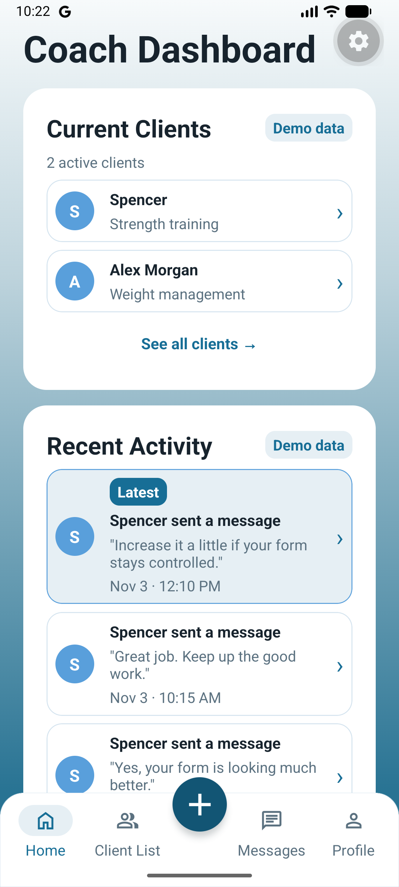
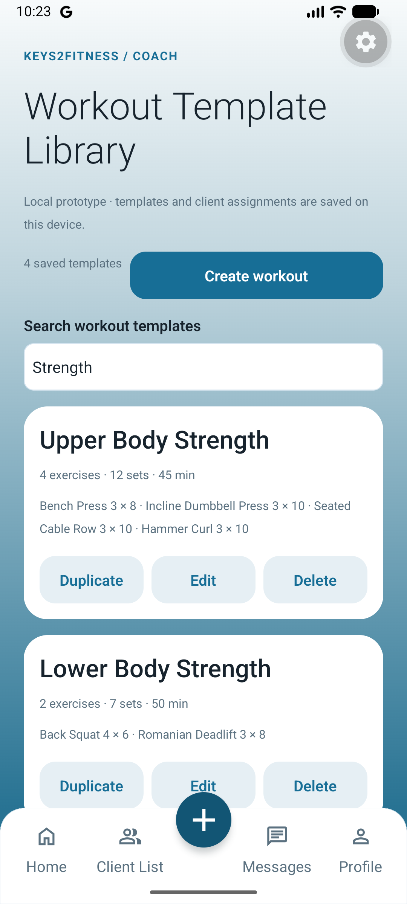
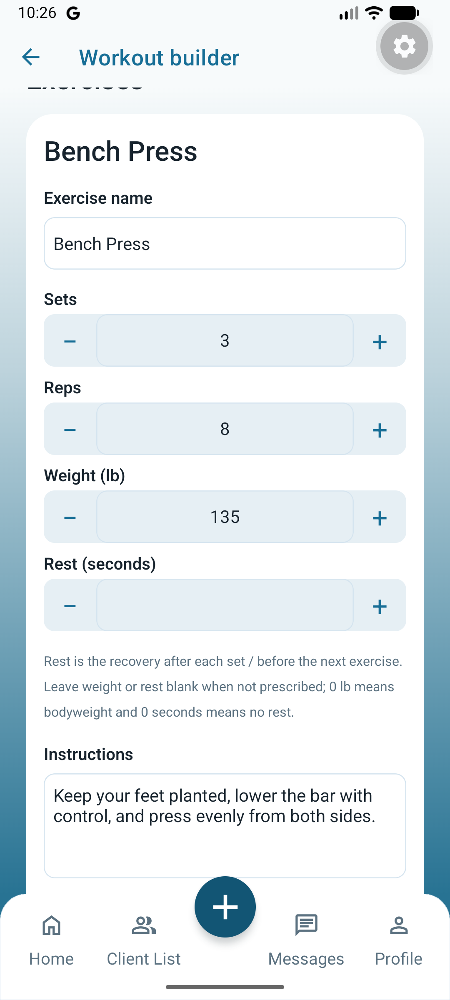
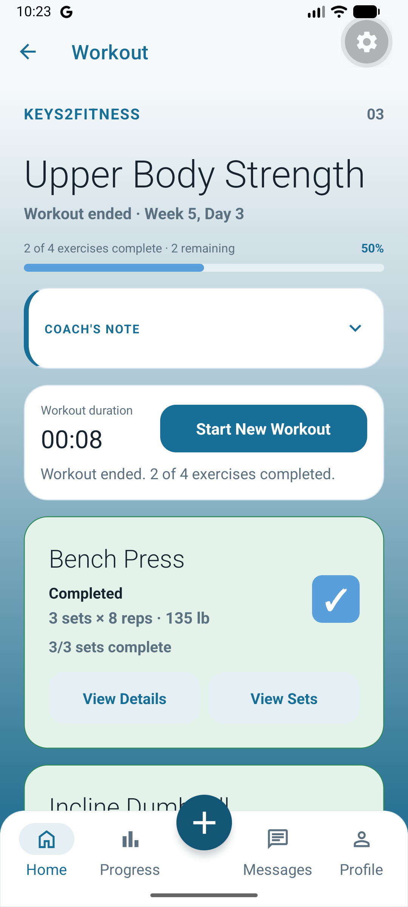
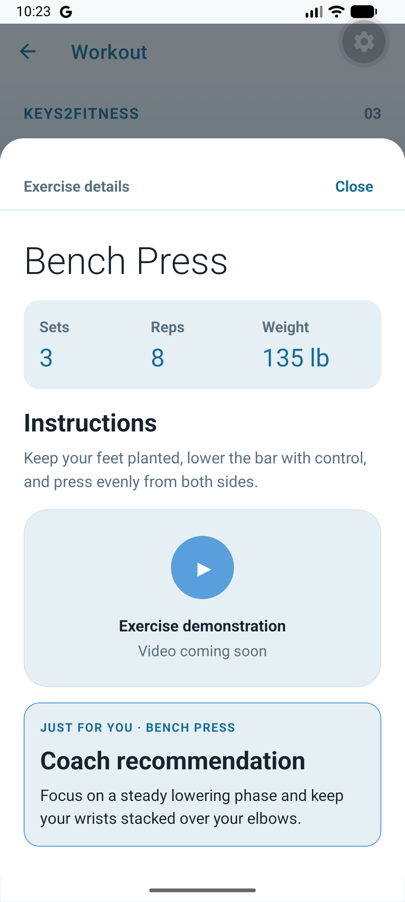
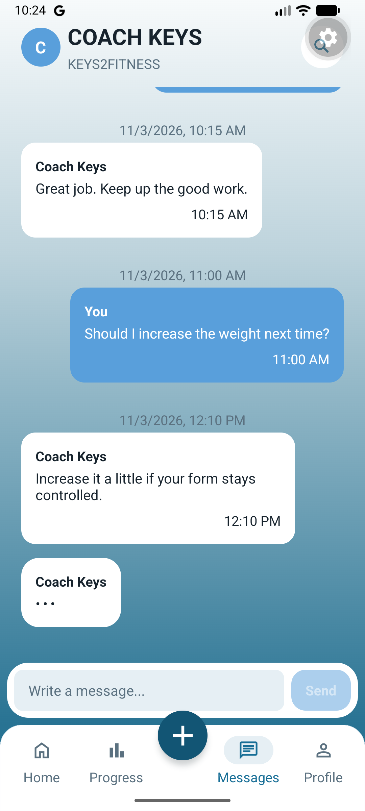

<p align="center">
  
</p>

<h1 align="center">Keys2Fitness</h1>
<p align="center"><strong>Personalized coaching. Organized workouts. Progress in one place.</strong></p>
<p align="center">Team 404 · Senior Project</p>

Keys2Fitness is a mobile application for a personal fitness coaching business. It gives coaches a place to organize clients, build workout plans, and provide exercise guidance, while clients can follow their workouts, record performed sets, and track their progress.

Built with **React Native, Expo, TypeScript, and Firebase**, the project targets Android and iOS from a shared codebase, with a web preview available through Expo.

## Contents

- [About the project](#about-the-project)
- [Team](#team)
- [Features and implementation status](#features-and-implementation-status)
- [App screenshots](#app-screenshots)
- [Technology and architecture](#technology-and-architecture)
- [Entity relationship diagram](#entity-relationship-diagram)
- [Getting started](#getting-started)
- [Testing and quality](#testing-and-quality)
- [Next-semester roadmap](#next-semester-roadmap)
- [Services and costs](#services-and-costs)
- [Project documentation](#project-documentation)

## About the project

### The problem

Workout plans, progress updates, and coaching conversations can become scattered across messages, spreadsheets, and separate apps. This makes it harder for a coach to manage clients and for clients to understand what to do next.

### Our solution

Keys2Fitness brings the coaching workflow into a role-based application:

- **Coaches** can view their client list, create reusable workout templates, edit exercise prescriptions, assign workout copies, and update recommendations for a specific client's assigned exercise.
- **Clients** can open assigned workouts, record reps and weight, pause and resume a session, confirm completion, and review their workout history.
- **Progress and communication** screens bring weight goals, measurements, profiles, and coaching conversations into the same experience. Backend integration is being developed incrementally.

### Core workout flow

**Coach creates or edits a plan → selects clients → confirms assignment → client opens the assigned copy → records performed sets → confirms completion → reviews history.**

The current workout implementation uses on-device storage and demo-client selection. Connecting that workflow to authenticated clients across devices is a planned backend milestone.

## Team

| Team member | Role |
| --- | --- |
| Spencer Le Bleu | Team lead / developer |
| Mary Nolan | Developer |
| Simrandeep Kaur | Developer |
| Jaden Saechao | Developer |
| Jubreen Dhillon | Developer |
| Anthony Thompson | Developer |

**Client:** Keys2Fitness personal fitness coaching business

**Course instructor:** Kenneth Elliott

## Features and implementation status

The project is a working UI prototype with selected Firebase-backed features. **Local/demo data and Firebase-backed data are currently separate sources.** Selecting a demo workout client does not switch the signed-in Firebase account.

| Area | Current implementation |
| --- | --- |
| Accounts and login | Firebase email/password signup and login; a Firestore user role determines the destination dashboard. Persistent native login sessions and centralized authorization still need integration work. |
| Coach dashboard and client list | Client summaries, activity, profiles, and navigation using clearly labeled demo data. |
| Workout template library | Create, edit, duplicate, search, and delete reusable plans; saved locally. |
| Exercise prescriptions | Sets, repetitions, optional weight in pounds, optional rest duration, instructions, alternatives, and validation. |
| Workout assignment | Review the workout and named recipients, confirm or cancel, and see saved assignment status. Independent copies are available to the selected demo clients on the same device. |
| Client-specific recommendations | Edit an existing assigned exercise's recommendation independently of reusable instructions and prescriptions, scoped to the client, workout, and exercise. |
| Workout tracking | Start, pause, resume, and record actual performed sets. Completion requires explicit confirmation; early-ended sessions are recorded separately. |
| Workout history | Quick-access history screen plus Home/Progress sections, newest-first completed records, client-scoped read-only actual-set details, completed totals, and active time persisted on-device. |
| Profiles and preferences | Client profile/preferences persist locally. Coach profile editing is currently a local UI prototype. |
| Goals and weight measurements | Authenticated Firestore reads/writes for the current weight goal and weight entries, including entry editing/deletion. Dashboard goal summaries also include mock data. |
| Messaging | Conversation UI, search, local message composition, and on-device read markers. End-to-end coach/client message delivery is not yet connected. |
| Check-ins | Demo check-in/history views and coach navigation. |
| Nutrition, media, and notifications | Planned work; nutrition and exercise-video entry points currently include placeholders. |

## App screenshots

These are **actual Android app captures from Expo Go**, using demo data—not Figma renders. They show the current UI; they do not imply cross-device synchronization. Screenshots are clickable for a larger view.

<table>
  <tr>
    <th>Coach dashboard</th>
    <th>Workout library</th>
    <th>Exercise prescription editor</th>
  </tr>
  <tr>
    <td><a href="K2F/docs/images/coach-dashboard.png"></a></td>
    <td><a href="K2F/docs/images/workout-library.png"></a></td>
    <td><a href="K2F/docs/images/prescription-editor.png"></a></td>
  </tr>
  <tr>
    <th>Client workout</th>
    <th>Exercise details</th>
    <th>Client messaging prototype</th>
  </tr>
  <tr>
    <td><a href="K2F/docs/images/client-workout.png"></a></td>
    <td><a href="K2F/docs/images/exercise-details.png"></a></td>
    <td><a href="K2F/docs/images/client-messages.png"></a></td>
  </tr>
</table>

See the [screenshot notes](K2F/docs/images/README.md) for capture context. Original UI mockups are available in [design references](K2F/design-references).

## Technology and architecture

| Technology | Purpose |
| --- | --- |
| React Native + Expo SDK 58 | Shared mobile application and development tooling |
| React 19 + TypeScript | Component UI and typed application/domain models |
| Expo Router | File-based navigation for coach and client flows |
| Firebase Authentication | Email/password account creation and sign-in |
| Cloud Firestore | Current user documents, weight goals, and weight measurements; additional backend integration is planned |
| AsyncStorage | Local workout library, assignments, session checkpoints/history, profile preferences, and read markers |
| Git + GitHub | Feature branches, pull requests, and team code review |
| Figma + Jira | UI design, user stories, subtasks, and sprint planning |

### Application structure

```text
Screens and reusable components
             ↓
Controller hooks and explicit workflow reducers
             ↓
Application services and pure domain functions
             ↓
Repository interfaces
             ↓
Local storage adapters / Firebase integrations
```

The workout subsystem separates prescription data from performed sets, preserves assigned workout snapshots, and serializes local storage operations. Its repository boundaries provide a place to introduce remote persistence while retaining the tested domain behavior. Some earlier screens still call Firebase directly; the layered structure is not yet uniform across the whole app.

```text
Keys2Fitness/
├── README.md                 Project overview and roadmap
└── K2F/                      Expo application — run npm commands here
    ├── assets/images/        Logo and application image assets
    ├── design-references/    Original screen mockups
    ├── docs/                 Architecture, setup, and verification notes
    ├── src/
    │   ├── app/              Expo Router screens and layouts
    │   ├── components/       Reusable UI
    │   ├── hooks/            Workflow controllers
    │   ├── workouts/         Workout domain, services, reducers, and storage
    │   ├── clients/          Demo client directory and state
    │   ├── messages/         Conversation UI, search, and read state
    │   ├── goals/            Goal calculations and sample data
    │   ├── profile/          Profile validation and local persistence
    │   ├── checkins/         Check-in models and sample data
    │   └── lib/              Firebase initialization
    └── tests/                Logic/integration tests and Android smoke drivers
```

More detail: [Workout architecture](K2F/docs/workout-architecture.md) · [State-machine audit](K2F/docs/implicit-state-machines.md)

## Entity relationship diagram

**Conceptual ERD — draft for backend integration and team review.** This diagram describes the core coaching/workout relationships using the current domain models. It is not a claim that every entity below is already a Firestore collection. In the local prototype, exercise and performed-set records are nested in workout/session JSON; workout clients use demo IDs rather than authenticated user IDs.

```mermaid
erDiagram
    USER ||--o{ WORKOUT_ASSIGNMENT : receives
    USER ||--o| CURRENT_GOAL : tracks
    USER ||--o{ WEIGHT_ENTRY : records
    WORKOUT_TEMPLATE ||--|{ TEMPLATE_EXERCISE : contains
    WORKOUT_TEMPLATE ||--o{ WORKOUT_ASSIGNMENT : copied_into
    WORKOUT_ASSIGNMENT ||--|{ ASSIGNED_EXERCISE : snapshots
    WORKOUT_ASSIGNMENT ||--o{ WORKOUT_SESSION : attempted_as
    WORKOUT_SESSION ||--|{ SESSION_EXERCISE : records
    SESSION_EXERCISE ||--o{ PERFORMED_SET : contains

    USER {
        string uid PK
        string email
        string role
    }
    WORKOUT_TEMPLATE {
        string id PK
        string title
        string updatedAt
    }
    TEMPLATE_EXERCISE {
        string id
        string name
        int sets
        int reps
        number weightLb
        int restSeconds
        string instructions
    }
    WORKOUT_ASSIGNMENT {
        string id PK
        string clientId FK
        string templateId FK
        string assignedAt
    }
    ASSIGNED_EXERCISE {
        string id
        string instructions
        string recommendation
    }
    WORKOUT_SESSION {
        string sessionId PK
        string workoutId FK
        string outcome
        number startedAt
        number finishedAt
    }
    SESSION_EXERCISE {
        string id
        boolean completed
    }
    PERFORMED_SET {
        string id
        string actualReps
        string actualWeightLb
        boolean completed
    }
    CURRENT_GOAL {
        string title
        number startWeightLb
        number targetWeightLb
        string startDate
    }
    WEIGHT_ENTRY {
        string id PK
        string date
        number weightLb
    }
```



`USER → WORKOUT_ASSIGNMENT` is a target integration relationship: the demo-client directory still needs to be linked to authenticated accounts. Template deletion preserves existing assigned snapshots, so `templateId` is a provenance reference rather than an enforced SQL foreign key. Nested exercise/set IDs are scoped by their parent template, assignment, or session; they are not necessarily globally unique database keys. Optional fields and draft/unstarted states are simplified in this conceptual view.

The current Firestore paths used in code are:

```text
users/{uid}
users/{uid}/goals/current
users/{uid}/weightEntries/{entryId}
```

Coach/client linking, conversations, notifications, nutrition, and media storage require further backend modeling. Replace or extend this draft with the team's approved ERD as those designs are finalized.

## Getting started

### Prerequisites

- **Node.js 22.23+** on the Node 22 line, or a newer compatible LTS release. Expo SDK 58 requires at least Node 22.13; the repository's Node-based test helpers also use modern module hooks.
- npm and Git.
- An Android emulator or a phone with an Expo Go version compatible with SDK 58. An iOS simulator requires macOS and Xcode.
- Access to an authorized Firebase project for account and Firestore-backed features.

### Install and run

```bash
git clone https://github.com/marynolan6/Keys2Fitness.git
cd Keys2Fitness/K2F
npm ci
npm start
```

Scan the QR code with Expo Go, or use the development-server shortcuts for an available emulator/simulator.

```bash
npm run android   # Start Expo for Android
npm run ios       # Start Expo for iOS
npm run web       # Start the web preview
```

For emulator and WSL networking instructions, see [Android development setup](K2F/docs/android-setup.md).

### Firebase and demo data

Firebase initialization currently lives in [`K2F/src/lib/firebase.ts`](K2F/src/lib/firebase.ts). To use your own authorized project, configure its web-app connection values there, enable Email/Password authentication, and enable Cloud Firestore. The current code does not read Firebase settings from an `.env` file.

- New signups create a `users/{uid}` document with the `client` role.
- A coach test account needs a corresponding user document with `role: "coach"`, provisioned by the team/project administrator. There is no in-app role-changing feature.
- Live signup, login, goals, and measurements depend on the Firebase project's configuration and access rules.
- Workout templates and demo-client assignments are stored on the device. They do not automatically synchronize to another phone or Firebase user.
- This repository does not currently include deployed Firestore security-rule or backend-function configuration. Production authorization is part of the integration roadmap.

## Testing and quality

Run these commands from `K2F/`:

```bash
npm run test:workouts
node --test tests/coach-tips.test.mjs tests/profile.test.mjs
npx tsc --noEmit
npm run lint
```

The workout suite covers validation, reducers, assignment isolation, local persistence/migrations, performed sets, pause/resume, completion/history, and client-specific recommendation edits. Android smoke drivers and feature verification notes supplement the logic tests.

Current verification records **94 passing workout tests**, **7 passing coach-tip tests**, and **4 passing profile tests**, plus passing TypeScript and changed-file lint. The Android smoke drivers automatically restore their pre-test workout data; see [smoke cleanup and recovery](K2F/docs/smoke-test-cleanup.md). Full-project lint still reports **33 existing errors and 2 warnings** in login, Progress, coach check-ins, root index, and DoorOpeningIntro; see the feature notes for context.

Android is the primary manually verified platform so far, including compact phones, large text, and tablet layouts. iOS stability and broader platform verification remain on the roadmap.

## Next-semester roadmap

The presentation identified backend linking, messaging, workout tracking integration, notifications, and iOS stability as the next major goals. The following **proposed CSC 191 roadmap** turns those goals into sprint-sized outcomes; it needs team/client approval and reconciliation with Jira's next-semester sprint numbering. It is not a record of already completed stories.

| Sprint | Proposed focus | Expected outcome |
| --- | --- | --- |
| **5** | Authenticated coach/client linking, role enforcement, native session persistence, and Firestore access rules | Real account identities replace preview-only client selection in the integrated workflow; access checks are tested. |
| **6** | Remote workout templates, assignments, performed-set checkpoints, and completion history | A coach assigns a plan and the intended client accesses it on another device, preserving snapshot and completion semantics. |
| **7** | Private messaging, read state, and push notifications | Coach/client conversations use shared backend data; notification permissions and delivery are tested. |
| **8** | Nutrition workflow and agreed media/check-in integrations | Replace prioritized placeholders with working client/coach flows and finalize the related storage model. |
| **9** | iOS stability, cross-platform regression, performance, release preparation, and handoff | A verified release candidate, updated documentation, deployment instructions, and a client demonstration. |

## Services and costs

The current app uses Firebase Authentication and Cloud Firestore through the Firebase client SDK; it does not require a separately hosted custom API server for its existing local workout flows. Cloud messaging, media storage, and any backend functions are planned integrations rather than completed services.

| Cost area | Planning basis |
| --- | --- |
| Development and builds | Expo provides local development tooling and optional hosted EAS services. Build quotas and paid-plan needs depend on the selected plan. |
| Authentication and database | Firebase charges/quotas depend on the product, plan, operations, storage, and traffic. Estimate actual users and usage before setting a production budget. |
| Media and backend processing | Revisit storage, transfer, and compute costs when video/photo and backend-function requirements are finalized. |
| App distribution | Apple and Google developer enrollment fees are separate from backend and build costs. |

**Budget status:** a workload-based production estimate still needs team/client review. Development within a free allowance is not a guaranteed zero-cost production deployment.

Official references: [Expo pricing](https://expo.dev/pricing) · [Firebase pricing](https://firebase.google.com/pricing) · [Apple Developer enrollment](https://developer.apple.com/programs/enroll/) · [Google Play registration](https://support.google.com/googleplay/android-developer/answer/6112435)

## Project documentation

- [Workout architecture and persistence](K2F/docs/workout-architecture.md)
- [Workout builder verification](K2F/docs/workout-builder-testing.md)
- [Assignment flow verification](K2F/docs/workout-assignment-testing.md)
- [Prescription and recommendation verification](K2F/docs/workout-prescription-testing.md)
- [Workout completion/history verification](K2F/docs/workout-completion-testing.md)
- [Completed-workout browsing and state-machine verification](K2F/docs/workout-history-testing.md)
- [Automatic smoke-test cleanup and recovery](K2F/docs/smoke-test-cleanup.md)
- [Application state-machine audit](K2F/docs/implicit-state-machines.md)
- [Theme and UI standards](K2F/docs/theme-standards.md)
- [Android environment setup](K2F/docs/android-setup.md)
- [Original UI design references](K2F/design-references)
- [Contributor/agent development instructions](K2F/AGENTS.md)
